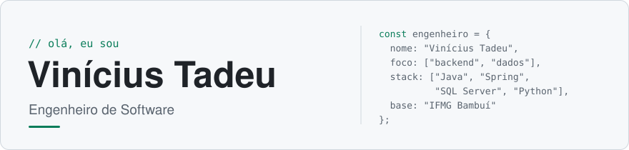
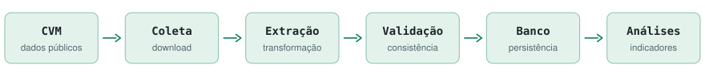

<picture>
  <source media="(prefers-color-scheme: dark)" srcset="https://raw.githubusercontent.com/ViniciusTAC/ViniciusTAC/main/assets/header-dark.svg">
  
</picture>

<br>

Sou formado em **Engenharia de Computação pelo Instituto Federal de Minas Gerais — IFMG Campus Bambuí**.

Trabalho com desenvolvimento de sistemas corporativos, APIs, automações, integrações e bancos de dados. Minha atuação é principalmente voltada ao backend, utilizando **Java, Spring Boot, SQL Server, Python e Node.js**, mas também desenvolvo interfaces com **Angular, Vue.js, JavaScript e TypeScript**.

No meu dia a dia, participo desde o entendimento das regras de negócio até a implementação, manutenção e implantação das soluções. Tenho interesse especial por projetos que resolvem problemas reais, organizam processos e transformam dados em informações úteis.

<p>
  <a href="mailto:viniciustacosta@gmail.com"></a>
  <a href="https://www.linkedin.com/in/vin%C3%ADcius-tadeu-andrade-costa/"></a>
  <a href="https://www.instagram.com/vinicius.tac/"></a>
</p>

<br>

## <samp>//</samp> Meu principal projeto

### TCC — Automação de dados da CVM para análise fundamentalista

Meu Trabalho de Conclusão de Curso foi desenvolvido para automatizar a coleta e a estruturação de dados financeiros públicos disponibilizados pela **Comissão de Valores Mobiliários — CVM**.

A proposta é reunir dados que normalmente estão distribuídos em diferentes arquivos e formatos, processá-los e armazená-los em uma estrutura organizada, facilitando sua utilização em análises fundamentalistas de empresas brasileiras de capital aberto.

#### Documentos processados

<table>
  <tr>
    <td><code>DFP</code><br><sub>Demonstrações Financeiras Padronizadas</sub></td>
    <td><code>ITR</code><br><sub>Informações Trimestrais</sub></td>
    <td><code>FCA</code><br><sub>Formulário Cadastral</sub></td>
    <td><code>IPE</code><br><sub>Informações Periódicas e Eventuais</sub></td>
    <td><code>FRE</code><br><sub>Formulário de Referência</sub></td>
  </tr>
</table>

#### Fluxo ETL

<picture>
  <source media="(prefers-color-scheme: dark)" srcset="https://raw.githubusercontent.com/ViniciusTAC/ViniciusTAC/main/assets/pipeline-dark.svg">
  
</picture>

#### O que o projeto realiza

- Coleta arquivos públicos disponibilizados pela CVM;
- Extrai e trata os dados encontrados nos documentos;
- Padroniza informações financeiras de diferentes períodos;
- Armazena os dados em banco relacional;
- Registra logs de execução, sucessos e falhas;
- Prepara uma base para consultas e indicadores fundamentalistas;
- Permite expandir o processamento para novas fontes e análises.

#### Estrutura

```text
src/
├── collectors/   # Coleta e download dos arquivos da CVM
├── extractor/    # Extração e transformação dos dados
├── models/       # Entidades e estruturas do sistema
├── service/      # Regras de processamento
├── repository/   # Persistência no banco de dados
├── utils/        # Funções auxiliares e logs
└── main.py       # Ponto inicial da aplicação
```

#### Tecnologias e requisitos

<samp>Python</samp> · <samp>Pandas</samp> · <samp>SQLAlchemy</samp> · <samp>SQLite</samp> · <samp>Beautiful Soup</samp> · <samp>Requests</samp>

Python 3.11+ · dependências via `requirements.txt` · ~16 GB livres em disco · 8 GB de RAM recomendados

<a href="https://github.com/ViniciusTAC/cvm-fundamentalist-analysis"></a>

<br>

## <samp>//</samp> Tecnologias que utilizo

Experiência construída na graduação, em estudos independentes, cursos, bootcamps e, principalmente, na aplicação dessas tecnologias em projetos acadêmicos e sistemas utilizados em ambientes profissionais.

<table>
  <tr>
    <td valign="top" width="25%"><b>Backend</b><br><br>
      
      
      
      
      
    </td>
    <td valign="top" width="25%"><b>Frontend</b><br><br>
      
      
      
      
      
      
      
    </td>
    <td valign="top" width="25%"><b>Bancos de dados</b><br><br>
      
      
      
    </td>
    <td valign="top" width="25%"><b>Ferramentas</b><br><br>
      
      
      
      
      
    </td>
  </tr>
</table>

<br>

## <samp>//</samp> Além do código

Competências que ajudam a transformar uma implementação técnica em uma solução que realmente pode ser utilizada e mantida.

| Competência | Como aplico |
| --- | --- |
| **Resolução de problemas** | Investigo falhas, identifico causas e desenvolvo correções |
| **Comunicação** | Traduzo necessidades de negócio para soluções técnicas |
| **Organização** | Estruturo tarefas, documentação e etapas de desenvolvimento |
| **Pensamento crítico** | Avalio impactos antes de implementar alterações |
| **Trabalho em equipe** | Compartilho conhecimento e colaboro nas decisões técnicas |
| **Adaptabilidade** | Aprendo novas ferramentas conforme as necessidades dos projetos |
| **Liderança** | Apoio colegas e contribuo com a organização das atividades |

<br>

## <samp>//</samp> Formação acadêmica

**Bacharelado em Engenharia de Computação**<br>
Instituto Federal de Educação, Ciência e Tecnologia de Minas Gerais — IFMG Campus Bambuí

<br>

## <samp>//</samp> Atividade

<picture>
  <source media="(prefers-color-scheme: dark)" srcset="https://raw.githubusercontent.com/ViniciusTAC/ViniciusTAC/output/pacman-contribution-graph-dark.svg">
  <source media="(prefers-color-scheme: light)" srcset="https://raw.githubusercontent.com/ViniciusTAC/ViniciusTAC/output/pacman-contribution-graph.svg">
  
</picture>
