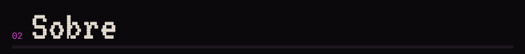
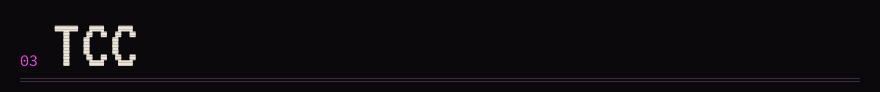
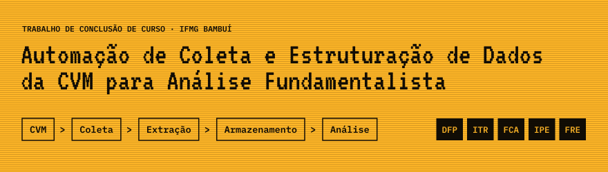
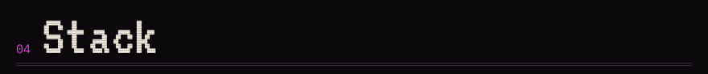
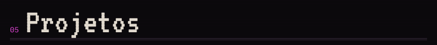
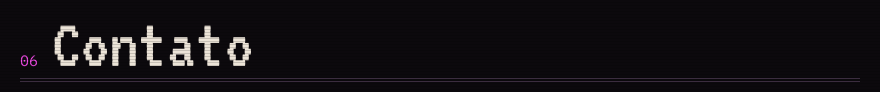
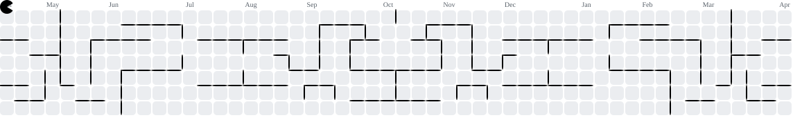

<!-- Visual baseado no portfólio: https://github.com/ViniciusTAC/portfolio -->

<a href="https://portfolio-kovine.netlify.app/"> java -jar vinicius.jar — Vinícius Tadeu, Engenheiro de Software Pleno" width="100%"></a>

Engenheiro de Software Pleno com foco em back-end: APIs REST e sistemas corporativos em **Java e Spring Boot**. Hoje evoluo os sistemas internos do **Sítio Recanto do Queijo**, da regra de negócio ao **SQL Server**, com integrações e automações em **Python**.

<a href="https://portfolio-kovine.netlify.app/"></a>&nbsp;
<a href="https://portfolio-kovine.netlify.app/Curr%C3%ADculo%20-%20Vinicius%20Tadeu%20Andrade%20Costa.pdf"></a>

<a href="https://github.com/ViniciusTAC"></a>&nbsp;&nbsp;
<a href="https://www.linkedin.com/in/vinicius-tadeu-andrade-costa"></a>&nbsp;&nbsp;
<a href="mailto:viniciustacosta@gmail.com"></a>&nbsp;&nbsp;
<a href="https://www.instagram.com/vinicius.tac/"></a>

<br>



Sou formado em Engenharia de Computação pelo IFMG e trabalho principalmente no back-end, com Java, Spring Boot, SQL Server, Python e Node.js: regras de negócio, modelagem relacional, APIs, integração entre sistemas e sustentação de aplicações em produção.

Comecei no Técnico em Informática do Pronatec. O primeiro emprego na área foi no Sicoob Sarom, mantendo sistemas em ASP Classic e participando da migração de um ERP legado. Foi a base prática da minha carreira em software corporativo.

No front-end atuo quando precisa, com Angular, PrimeNG, TypeScript e Vue.js, principalmente em interfaces integradas ao back-end.

#### `[07/2025 - atual]` Sítio Recanto do Queijo
**Engenheiro de Software Pleno**

- Desenvolvi e evoluí APIs e módulos back-end em Java, Spring Boot e Node.js, com as regras de negócio dos sistemas corporativos usados na operação.
- Integrei sistemas internos, bancos de dados e APIs REST para dar suporte aos fluxos operacionais e logísticos da empresa.
- Criei e otimizei consultas, views e procedures em SQL Server.
- Automatizei a coleta, o tratamento e a estruturação de dados com Python, reduzindo o esforço manual da equipe.
- Implementei interfaces em Angular, PrimeNG e TypeScript conectadas ao back-end.

<sub><samp>JAVA / SPRING BOOT / SQL SERVER / PYTHON / NODE.JS / ANGULAR / DOCKER / CI/CD</samp></sub>

#### `[02/2024 - 07/2025]` Sítio Recanto do Queijo
**Engenheiro de Software Júnior**

- Contribuí para a evolução do ERP da empresa com funcionalidades em Java e Spring Boot, traduzindo regras de negócio em lógica back-end.
- Implementei e mantive APIs REST para integrar os módulos do ERP.
- Desenvolvi scripts e pipelines de integração em Python para automatizar processos operacionais.
- Elaborei consultas SQL avançadas e relatórios para apoiar análises e decisões gerenciais.

<sub><samp>JAVA / SPRING BOOT / SQL SERVER / PYTHON / NODE.JS / DOCKER</samp></sub>

#### `[10/2023 - 01/2024]` Fusion Tecnologia
**Estagiário de Desenvolvimento de Software**

- Desenvolvi telas e componentes reativos com Vue.js e Vuetify para aplicações web corporativas.
- Integrei as interfaces ao back-end em Ruby on Rails.
- Apoiei a manutenção e a evolução das aplicações, versionando com Git e GitLab.

<sub><samp>VUE.JS / VUETIFY / RUBY ON RAILS / GIT / GITLAB</samp></sub>

#### `[04/2021 - 02/2022]` Sicoob Sarom
**Assistente de Desenvolvimento**

- Contribuí para a modernização de um ERP legado, participando da migração de ASP Classic para uma arquitetura web moderna.
- Desenvolvi funcionalidades com Vue.js, Vuetify e Node.js para interfaces usadas nas rotinas internas.
- Construí consultas e relatórios complexos em MySQL para apoiar a tomada de decisão.

<sub><samp>ASP CLASSIC / VUE.JS / VUETIFY / NODE.JS / MYSQL</samp></sub>

<br>

| <samp>FICHA</samp> | |
| --- | --- |
| <samp>FORMAÇÃO</samp> | Bacharelado em Engenharia de Computação, IFMG (01/2017 a 09/2025) |
| <samp>TÉCNICO</samp> | Técnico em Informática, Pronatec (2014 a 2015) |
| <samp>CERTIFICAÇÕES</samp> | Docker: criando e gerenciando containers; Python Avançado; TypeScript parte 3 |
| <samp>FERRAMENTAS</samp> | Git, GitHub, GitLab, Docker, CI/CD, Kanban |
| <samp>IDIOMAS</samp> | Inglês e espanhol intermediários |
| <samp>LOCAL</samp> | São Roque de Minas, MG |

<details>
<summary><b>Além do código</b></summary>
<br>

| Competência | Como aplico |
| --- | --- |
| **Resolução de problemas** | Investigo falhas, identifico causas e desenvolvo correções |
| **Comunicação** | Traduzo necessidades de negócio para soluções técnicas |
| **Organização** | Estruturo tarefas, documentação e etapas de desenvolvimento |
| **Pensamento crítico** | Avalio impactos antes de implementar alterações |
| **Trabalho em equipe** | Compartilho conhecimento e colaboro nas decisões técnicas |
| **Adaptabilidade** | Aprendo novas ferramentas conforme as necessidades dos projetos |
| **Liderança** | Apoio colegas e contribuo com a organização das atividades |

</details>

<br>



<a href="https://github.com/ViniciusTAC/cvm-fundamentalist-analysis"> Coleta > Extração > Armazenamento > Análise" width="100%"></a>

Software em Python que coleta, estrutura e integra dados financeiros públicos da **CVM**, para aplicar análise fundamentalista em empresas de capital aberto. Os documentos (DFP, ITR, FCA, IPE e FRE) passam por uma arquitetura ETL e vão para um banco relacional. Logs detalhados registram cada sucesso e cada falha.

```text
cvm-fundamentalist-analysis/
├── collectors/   coleta e download
├── extractor/    extração e transformação
├── models/       entidades
├── service/      regras de processamento
├── repository/   controle do banco
├── utils/        auxiliares e logger
└── main.py       script principal
```

| <samp>TECNOLOGIAS</samp> | <samp>REQUISITOS</samp> |
| --- | --- |
| Python · BeautifulSoup · Requests · Pandas · SQLAlchemy · SQLite | Python 3.11+ · 16 GB livres em disco · 8 GB de RAM (recomendado) |

<a href="https://github.com/ViniciusTAC/cvm-fundamentalist-analysis"></a>&nbsp;
<a href="https://repositorio.ifmg.edu.br/items/0a3a3ec7-1072-4986-8b7c-588560290569"></a>&nbsp;
<a href="https://repositorio.ifmg.edu.br/bitstreams/0c9d6010-5bef-4d33-9f78-5ed2f45791cc/download"></a>

<br>



<details open>
<summary><b>Java + Spring</b></summary>
<br>

<table>
  <tr><td><samp>USO HOJE</samp></td><td>APIs e módulos back-end com Spring Boot</td></tr>
  <tr><td><samp>NO DIA A DIA</samp></td><td>APIs REST, regras de negócio, integrações, ERP</td></tr>
  <tr><td><samp>PRIMEIRO CONTATO</samp></td><td>Técnico em Informática, Pronatec</td></tr>
  <tr><td><samp>JÁ IMPLEMENTEI</samp></td><td>Enxame de Partículas (PSO)</td></tr>
</table>

Java e Spring Boot são a base do meu trabalho. No Sítio Recanto do Queijo desenvolvo APIs e módulos back-end para os sistemas corporativos usados na operação: analiso a demanda e a regra de negócio, implemento, integro com banco de dados e outros sistemas e cuido da sustentação em produção.

Na faculdade aprofundei em Programação Orientada a Objetos e implementei o algoritmo de Otimização por Enxame de Partículas (PSO) para minimizar funções como Esfera, Rosenbrock e Rastrigin.

</details>

<details>
<summary><b>SQL</b></summary>
<br>

<table>
  <tr><td><samp>USO HOJE</samp></td><td>SQL Server</td></tr>
  <tr><td><samp>JÁ USEI</samp></td><td>MySQL</td></tr>
  <tr><td><samp>NO DIA A DIA</samp></td><td>Consultas, views, procedures, relatórios, modelagem relacional</td></tr>
</table>

Boa parte do valor de um sistema corporativo está no dado. Hoje crio e otimizo consultas, views, procedures e estruturas relacionais em SQL Server para atender às regras de negócio e dar suporte à operação. Antes, no Sicoob Sarom, construí consultas e relatórios complexos em MySQL.

</details>

<details>
<summary><b>Python</b></summary>
<br>

<table>
  <tr><td><samp>USO HOJE</samp></td><td>Automação e pipelines de integração</td></tr>
  <tr><td><samp>PRIMEIRO CONTATO</samp></td><td>1º período da graduação</td></tr>
  <tr><td><samp>JÁ IMPLEMENTEI</samp></td><td>Árvore B+, compilador, ETL da CVM</td></tr>
</table>

No trabalho, uso Python para automatizar a coleta, o tratamento e a estruturação de dados, com scripts e pipelines de integração que reduzem o esforço manual da equipe. Na graduação implementei uma árvore B+ e um analisador que devolvia a árvore de sintaxe. Também foi a linguagem do meu TCC.

</details>

<details>
<summary><b>Web</b></summary>
<br>

<table>
  <tr><td><samp>USO HOJE</samp></td><td>Angular, PrimeNG, TypeScript</td></tr>
  <tr><td><samp>JÁ USEI</samp></td><td>Vue.js, Vuetify, Node.js, ASP Classic</td></tr>
  <tr><td><samp>PRIMEIRO CONTATO</samp></td><td>Técnico em Informática, Pronatec</td></tr>
</table>

Comecei com HTML, CSS e JavaScript no Pronatec. Passei por ASP Classic, Vue.js, Vuetify e Node.js no Sicoob Sarom, Vue.js com Ruby on Rails na Fusion Tecnologia, e hoje implemento interfaces em Angular, PrimeNG e TypeScript conectadas ao back-end em Spring Boot.

</details>

<br>



Meus sistemas em Java e Spring Boot são internos das empresas onde trabalho, então o código não é público. Aqui ficam os projetos abertos.

<table>
  <tr>
    <td width="34%" valign="top">
<pre>
A FAZER  FAZENDO  PRONTAS
[====]   [===]    [==]
[==]     [=]      [====]
[===]             [=]
</pre>
    </td>
    <td valign="top">
      <b><a href="https://github.com/ViniciusTAC/ProjetoVue">Quadro Kanban</a></b><br>
      Quadro de atividades com colunas para cada estado da tarefa: A Fazer, Fazendo e Prontas.<br>
      <sub><samp>VUE 2 / VUETIFY 2</samp></sub>
    </td>
  </tr>
  <tr>
    <td valign="top">
<pre>
front-end
    │
    ▼
rails api ──► postgresql
</pre>
    </td>
    <td valign="top">
      <b><a href="https://github.com/ViniciusTAC/backend">API do Quadro Kanban</a></b><br>
      Back-end do quadro: as APIs que gerenciam tarefas e colunas, em Rails com PostgreSQL.<br>
      <sub><samp>RUBY ON RAILS / POSTGRESQL</samp></sub>
    </td>
  </tr>
  <tr>
    <td valign="top">
<pre>
&lt;aula&gt;
  conceitos
  tecnologias
&lt;/aula&gt;
</pre>
    </td>
    <td valign="top">
      <b><a href="https://github.com/ViniciusTAC/MiniCurso-Web">Minicurso de Desenvolvimento Web</a></b><br>
      Minicurso introdutório que ministrei, com uma visão geral dos conceitos e tecnologias usados para criar sites.<br>
      <sub><samp>MATERIAL DE AULA</samp></sub>
    </td>
  </tr>
</table>

<br>



O formulário de contato está no portfólio. Também respondo por e-mail e LinkedIn.

<a href="https://portfolio-kovine.netlify.app/contato"></a>&nbsp;
<a href="mailto:viniciustacosta@gmail.com"></a>&nbsp;&nbsp;
<a href="https://www.linkedin.com/in/vinicius-tadeu-andrade-costa"></a>

<br>

<picture>
  <source media="(prefers-color-scheme: dark)" srcset="https://raw.githubusercontent.com/ViniciusTAC/ViniciusTAC/output/pacman-contribution-graph-dark.svg">
  <source media="(prefers-color-scheme: light)" srcset="https://raw.githubusercontent.com/ViniciusTAC/ViniciusTAC/output/pacman-contribution-graph.svg">
  
</picture>

<sub><samp>© Vinícius Tadeu Andrade Costa (Kovine)</samp></sub>
